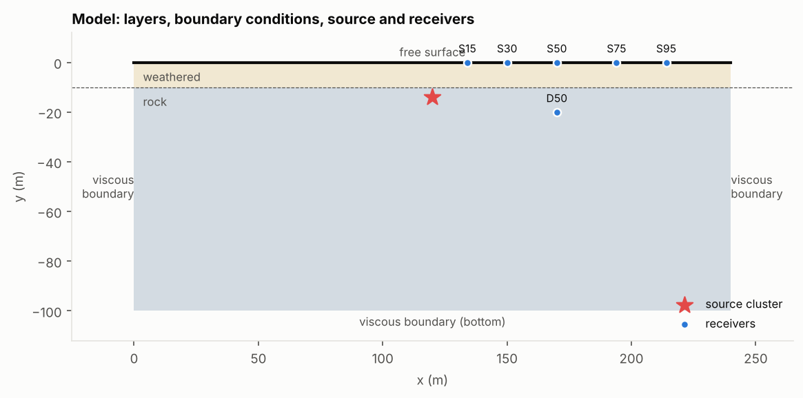
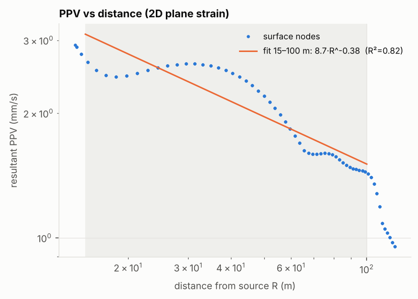
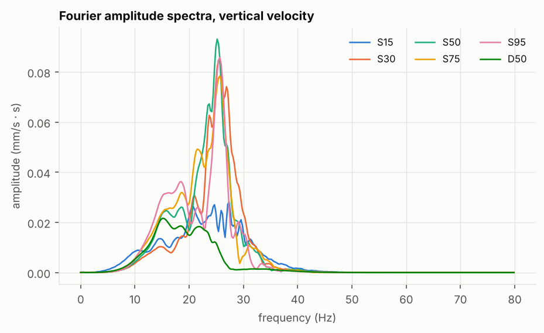
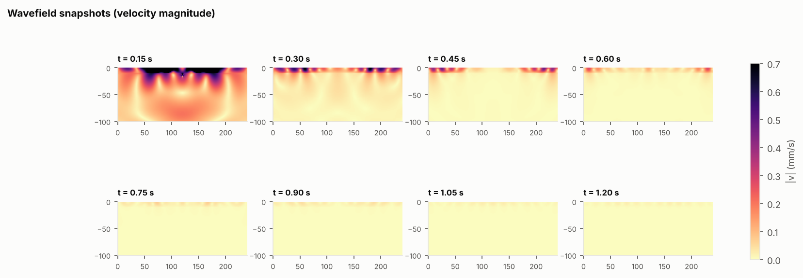

# ppv_sim: Blast-Induced Ground Vibration in OpenSeesPy

A modular Python workflow that simulates how a short transient disturbance travels through a layered rock mass and then measures the resulting vibration the way a blast-monitoring seismograph would: **peak particle velocity (PPV)**, arrival time, attenuation with distance, frequency content and duration.

It uses a 2D plane-strain finite element model built with [OpenSeesPy](https://openseespydoc.readthedocs.io/), with a free surface, absorbing (viscous) boundaries and a prescribed synthetic source pulse.

> **Please read before using the numbers.**
> The source is a **prescribed Ricker pulse**, not an explosive model. There is no charge, borehole, detonation or fracture-zone physics, and the amplitude is arbitrary, so **absolute PPV values are not calibrated** to any real blast. The model is **2D**, so wave attenuation differs from real 3D ground, and only in-plane motion exists. Use it to understand *trends* (how layering, distance and frequency interact), not to predict site vibration or check regulatory limits.



## What it does

1. **Meshes** a 240 m × 100 m cross-section with 2 m square elements (6,171 nodes, 6,000 quads) and two horizontal layers (weathered layer over rock).
2. **Applies boundary conditions:** free surface on top; Lysmer–Kuhlemeyer viscous dashpots on the left, right and bottom edges so outgoing waves are absorbed instead of reflecting.
3. **Applies a source:** a Ricker pulse (15 Hz centre frequency) on a self-equilibrated cluster of four radial nodal forces.
4. **Integrates in time** with the Newmark average-acceleration method (β = ¼, γ = ½), Rayleigh damping (1 % at 5 and 50 Hz), 0.5 ms steps for 1.2 s.
5. **Extracts vibration metrics:** component and resultant PPV, arrival time and a power-law attenuation fit.
6. **Analyses the waveforms:** Fourier spectrum, dominant and zero-crossing frequency, spectrogram and energy-based significant duration.
7. **Plots** nine figures and writes CSV/JSON summaries.

## Quick start

Requires **Python 3.10 or newer** (3.10–3.12 recommended for OpenSeesPy wheels).

```bash
git clone <this-repo-url>
cd ppv_sim
pip install openseespy numpy scipy matplotlib
python main.py
```

The full run takes roughly 1–2 minutes and writes everything to `results/`. Figures are saved as PNG files (the plotting backend is non-interactive), so open them from the `results` folder.

Run the consistency checks (about 40 s, writes to `results_test/`):

```bash
python test_integration.py
```

`main.py` is the only file you need to run; the other modules are imported by it.

## Example results (default run)

| Receiver | Distance R (m) | Resultant PPV (mm/s) | First arrival (s) | Dominant freq., vertical (Hz) | Duration, vertical (s) |
|---|---:|---:|---:|---:|---:|
| S15 | 19.8 | 2.46 | 0.064 | 27.3 | 0.188 |
| S30 | 33.1 | 2.62 | 0.076 | 25.4 | 0.176 |
| S50 | 51.9 | 2.13 | 0.089 | 25.1 | 0.234 |
| S75 | 75.3 | 1.60 | 0.101 | 25.6 | 0.349 |
| S95 | 95.0 | 1.46 | 0.110 | 25.6 | 0.410 |
| D50 (20 m deep) | 50.4 | 0.49 | 0.067 | 15.1 | 0.129 |

Attenuation fit over 15–100 m (94 surface nodes): **PPV ≈ 8.7 · R^−0.38 mm/s, R² = 0.82**. This is a descriptive trend for this 2D model, not a site attenuation law.

What the run shows:

- PPV does **not** follow a single power law. It rises, dips and plateaus with distance, and the time of the PPV peak jumps near R ≈ 67 m as a different wave phase becomes the largest arrival.
- A 15 Hz pulse produces surface vibration peaking at about 25 Hz, while the deep receiver peaks near 15 Hz. This is consistent with the soft layer filtering and trapping energy (an interpretation, not proven by the model; a layer-thickness sweep would test it).
- Significant duration grows with distance as the wavetrain disperses.
- Results are mirror-symmetric about the source, and horizontal PPV is essentially zero directly above it, as symmetry requires.

<p align="center">
  
  
</p>
<p align="center">
  
</p>

## Project structure

```
ppv_sim/
├── config.py              Shared configuration, units and wave speeds
├── model_setup.py         Mesh, materials, boundary conditions, source nodes
├── excitation.py          Ricker source pulse
├── dynamic_analysis.py    Newmark time integration and recording
├── ppv_analysis.py        PPV, arrival time, attenuation fit
├── signal_analysis.py     FFT, PSD, spectrogram, energy duration
├── visualization.py       Figures
├── main.py                Runs the whole workflow
├── test_integration.py    Consistency checks on a shorter run
└── results/               Outputs (figures, CSV, JSON)
```

Design rule: downstream modules never rebuild the model. They use the exact node tags and coordinates produced by `model_setup.py` and read the exact response histories written by `dynamic_analysis.py`, so the solver and the analysis cannot disagree about where a receiver is.

## Configuration

Everything is set in the `Config` dataclass in `config.py`. A changed run is one line:

```python
from config import Config
import main

main.main(Config(duration=0.8, h=1.0, out_dir="results_fine"))
```

| Group | Parameters |
|---|---|
| Geometry / mesh | `width`, `depth`, `h`, `thickness` |
| Ground | `layers` (name, thickness, E, ν, ρ for each layer) |
| Source | `source_x`, `source_depth`, `pulse_fc`, `pulse_t0`, `pulse_peak_force` |
| Time | `dt`, `duration`, `damp_ratio`, `damp_f1`, `damp_f2` |
| Receivers | `receivers` as (name, x-offset from source, depth) |
| Mesh rule | `pts_per_wavelength`, `f_max_factor` |

Units are SI throughout (m, s, kg, N/m for the unit-thickness 2D model, Pa); PPV is reported in mm/s.

**Mesh resolution matters.** The mesh resolves frequencies up to `Vs / (8 h)` (38.8 Hz for the default weathered layer). `main.py` prints a warning if the pulse needs more than the mesh can resolve; if you raise `pulse_fc` or soften a layer, reduce `h`.

**Source depth snaps to the grid.** The source is placed at the nearest grid node. With `h = 2` m the default 15 m depth becomes 14 m (see `src_xy` in `results/results.npz`). Choose a depth that is a multiple of `h` to place it exactly.

## Outputs (`results/`)

| File | Contents |
|---|---|
| `01_model.png` … `09_snapshots.png` | Model layout, source pulse, waveforms (vertical and horizontal), PPV vs distance, spectra, spectrogram, cumulative energy, wavefield snapshots |
| `ppv.csv` | One row per surface node: position, distance, component and resultant PPV, peak time, arrival |
| `ppv_summary.json` | Attenuation fit and per-receiver PPV and arrival |
| `signal_summary.json` | Frequency, centroid and duration measures for each receiver and component |
| `config.json` | The configuration used for the run |
| `mesh.npz`, `results.npz` | Mesh and full response histories (regenerated by `main.py`; large, so consider leaving them out of version control) |

## Method in brief

- **Elasticity and waves:** plane-strain isotropic elasticity; P- and S-wave speeds from the Lamé constants.
- **Spatial discretisation:** four-node isoparametric quadrilaterals, 2 × 2 Gauss integration.
- **Time integration:** Newmark β = ¼, γ = ½ (unconditionally stable, no algorithmic damping). The effective matrix is constant for a linear model, so it is factorised once (`BandSPD` solver with `-factorOnce`), which makes the run fast.
- **Damping:** Rayleigh, C = αM + βK, set to 1 % at 5 and 50 Hz.
- **Absorbing boundaries:** dashpots with c = ρVA (P-wave in the normal direction, S-wave in the tangential direction), built from a fixed ground node and a `zeroLength` element. Exact for normally incident waves, approximate for oblique, low-frequency and surface waves.
- **Source:** Ricker wavelet f(t) = (1 − 2a)e^(−a), a = (π f_c (t − t₀))², with zero net impulse.
- **PPV:** the peak over time of the velocity vector magnitude, in mm/s; arrival is the first time the resultant exceeds 5 % of its peak.
- **Signal analysis:** detrend and Tukey taper, FFT, zero-crossing frequency of the peak cycle, STFT spectrogram, and cumulative-energy (5–95 %) significant duration.

## Testing

`test_integration.py` runs a shorter simulation and checks the contract between modules: node selection and coordinates, output array shapes, timestamps, finite values, unit consistency (velocity versus the numerical derivative of displacement, and acceleration versus the derivative of velocity), arrival times within physically possible P- and S-wave bounds, and a finite signal summary. These are consistency checks, not validation against field data.

## Limitations

- 2D plane strain: cylindrical spreading, no transverse component; attenuation exponents are not transferable to 3D.
- Linear elastic, homogeneous layers: no joints, faults, fractured zones, plasticity or topography.
- Prescribed synthetic source with arbitrary amplitude: not a blast model and not calibrated.
- Mesh limit of about 37.5 Hz for the default setup; real blast vibration contains higher frequencies.
- Dashpot boundaries are imperfect for oblique, low-frequency and surface waves. The PPV drop within about 10 m of the side edges is most likely a boundary artefact; a larger domain would confirm it.
- No validation against field seismograph data has been done.

## Suggested next steps

- Mesh, time-step and domain-size convergence studies.
- Parametric study of layer stiffness, thickness and pulse frequency.
- Calibration and comparison against field vibration records.
- 3D model or a perfectly matched layer (PML) boundary.
- Frequency-dependent comparison against a vibration standard using the zero-crossing frequency.

## References

- Lysmer, J. and Kuhlemeyer, R. L. (1969). Finite dynamic model for infinite media. *J. Engineering Mechanics Division, ASCE*, 95(EM4).
- Kuhlemeyer, R. L. and Lysmer, J. (1973). Finite element method accuracy for wave propagation problems. *J. Soil Mechanics and Foundations Division, ASCE*, 99(SM5).
- Newmark, N. M. (1959). A method of computation for structural dynamics. *J. Engineering Mechanics Division, ASCE*, 85(EM3).
- Ricker, N. (1953). The form and laws of propagation of seismic wavelets. *Geophysics*, 18(1).
- Siskind, D. E. et al. (1980). Structure response and damage produced by ground vibration from surface mine blasting. U.S. Bureau of Mines RI 8507.
- Zhu, M., McKenna, F. and Scott, M. H. (2018). OpenSeesPy: Python library for the OpenSees finite element framework. *SoftwareX*, 7.


## License

Released under the [MIT License](LICENSE).

## Author

Sayan Mondal, B.Tech Mining Engineering, IIEST Shibpur.

